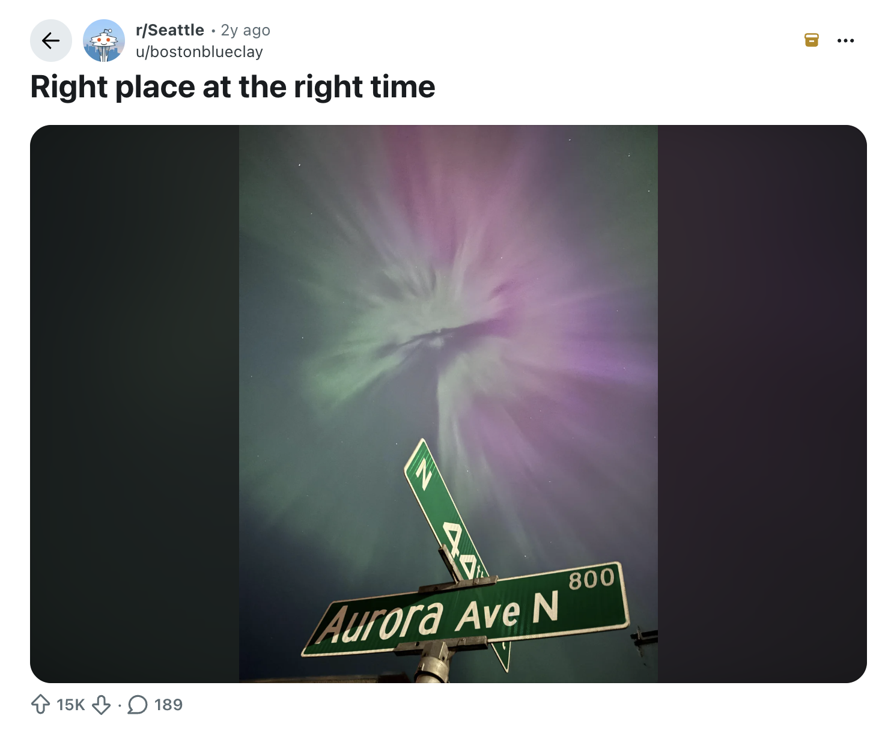
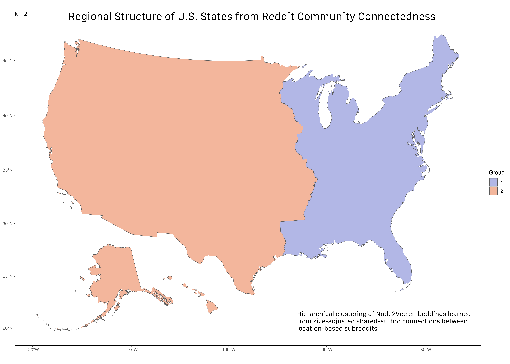
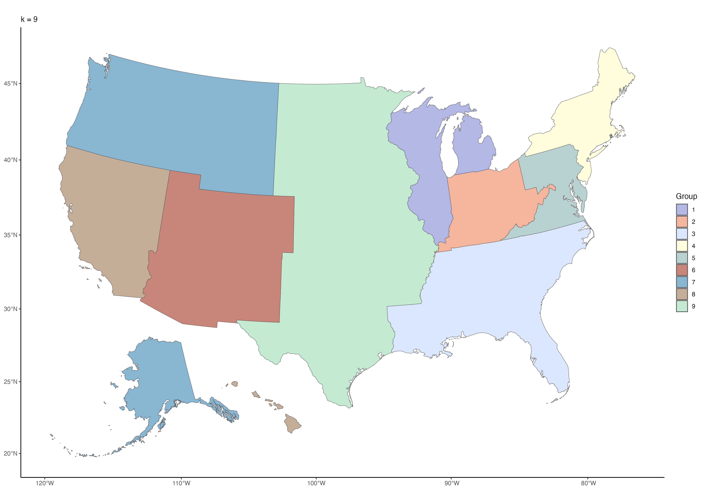
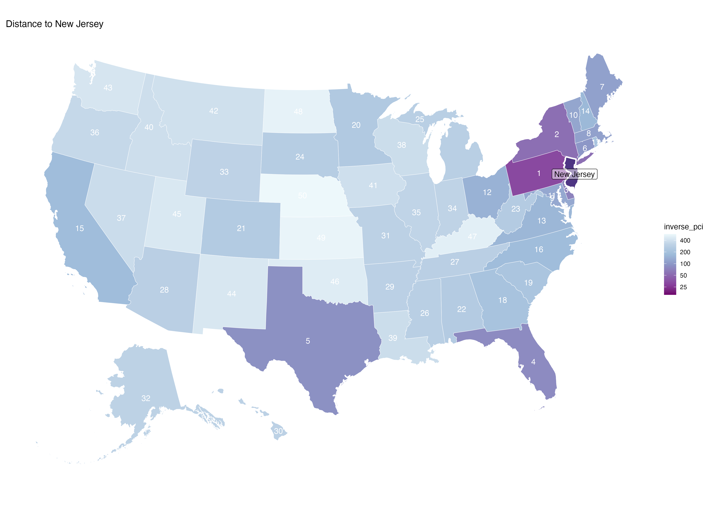

## To What Extent Does Online Connectedness Between Places Reflect Geographic Proximity?


::: {.columns}

::: {.column width="40%"}

### Data

- **611** U.S. location-based subreddits
- **14 months** of observation (June 2023 ~ July 2024)
- **64.7M** Reddit posts & comments
- **4.1M** unique contributors
- Data-intensive analysis with **PySpark + AWS**

:::
::: {.column width="60%"}

::: {.callout-note appearance="simple" collapse="true" title='What is a "location-based subreddit"?'}

Location-based subreddits are online communities organized around physical places. 



:::

:::
:::

## From Reddit Activity to Place Connectedness

::: {.columns}

::: {.column width="38%"}

### Unit of Analysis

**Pairs of subreddits**

- `186,355` possible subreddit pairs

### Geographic Augmentation

Connect online communities with their physical counterparts

- Integrating geographic coordinates (latitude and longitude)
- State-level shapefile (Census Bureau TIGER/Line)


:::

::: {.column width="62%"}

### Measuring Shared Participation

For each pair of subreddits $i$ and $j$:

$$
N_{ij} = |A_i \cap A_j|
$$

where $A_i$ and $A_j$ are their sets of contributing authors.

$$
PCI_{ij} =
\frac{N_{ij}}
{\sqrt{|A_i||A_j|}}
$$

**Place Connectedness Index (`pci`)** measures shared participation relative to the sizes of the two communities.

:::

:::

<div class="flow compact">

<div class="flow-step">
<strong>Reddit Activity</strong>
<small>Posts and comments from location-based communities</small>
</div>

<div class="flow-arrow">→</div>

<div class="flow-step">
<strong>Author Sets</strong>
<small>Unique contributors to each subreddit</small>
</div>

<div class="flow-arrow">→</div>

<div class="flow-step">
<strong>Subreddit Pairs</strong>
<small>Count shared contributors between communities</small>
</div>

<div class="flow-arrow">→</div>

<div class="flow-step accent">
<strong>Connectedness</strong>
<small>Raw overlap + size-adjusted PCI</small>
</div>

</div>

::: {.fragment}

::: {.callout-tip title='Example Data Frame' collapse="true" appearance="simple"}
```{.r}
# A tibble: 5 × 6
  sr1        sr2         n_shared_authors    pci geo_dist_mi same_state
  <chr>      <chr>                  <dbl>  <dbl>       <dbl> <lgl>     
1 newark     newjersey               1492 0.0887       49.7  TRUE      
2 jerseycity newark                   661 0.0680        5.80 TRUE      
3 newark     nyc                      435 0.0229       12.7  FALSE     
4 hoboken    newark                   287 0.0427        7.40 TRUE      
5 newark     southjersey              258 0.0275       95.1  TRUE  
```
:::

:::


## From Online Communities to Relationships Between Places

<div class="flow compact">

<div class="flow-step">
<strong>Reddit Users</strong>
<small>Participate across multiple local communities</small>
</div>

<div class="flow-arrow">→</div>

<div class="flow-step">
<strong>Shared Participation</strong>
<small>Connect pairs of location-based subreddits</small>
</div>

<div class="flow-arrow">→</div>

<div class="flow-step">
<strong>Place Connectedness</strong>
<small>Measure pairwise relationships</small>
</div>

<div class="flow-arrow">→</div>

<div class="flow-step accent">
<strong>Geographic Structure?</strong>
<small>Distance, borders, and regions</small>
</div>

</div>

::: {.columns}

::: {.column width="58%"}

### Research Question


- Does connectedness decline with **geographic distance**?
- Does the **strength of this relationship vary with distance**?
- Does being in the **same state** matter beyond distance?
- Can connectedness alone recover recognizable **geographic regions**?

:::

::: {.column width="42%"}

### Research Inspiration

Bailey et al. (2018) used Facebook friendship networks to measure **social connectedness between places**, relating it to geographic distance and political boundaries[@baileySocialConnectednessMeasurement2018].

Their connectedness-based clustering further demonstrated how network relationships can reveal geographic regions.

:::

:::


## Does Connectedness Decline With Geographic Distance?

### Pairwise Regression

I modeled the number of shared authors between each pair of location-based
subreddits as a function of their geographic relationship.

$$
\log(N_{ij} + 0.5)
=
\beta_1 \log(D_{ij})
+
\beta_2 \text{SameState}_{ij}
+
\alpha_i + \alpha_j
+
\epsilon_{ij}
$$

::: {.columns}

::: {.column width="55%"}

### Fixed-Effects Results

::: {.small-table}

| Model | Distance | Same State | Adj. $R^2$ |
|---|---:|---:|---:|
| **All pairs** | **−0.458*** | **+1.087*** | 0.791 |
| **≤ 200 miles** | **−0.871*** | **+1.187*** | 0.888 |
| **> 200 miles** | **−0.398*** | **+0.730*** | 0.786 |

:::

::: {.tiny}
$*$ $p < .001$. Subreddit fixed effects included in all models.
:::

:::

::: {.column width="45%"}

### What Do We Learn?

**Connectedness decreases with distance**

**Conditional on distance, connectedness is stronger within states**

Geographic distance and state boundaries can explain some of the variation in patterns of shared online participation

:::

:::

## Can Connectedness Reconstruct Geographic Regions?

Using the **network of shared
Reddit participation itself** to test whether clustering yields geographically cohesive regions

<div class="flow compact">

<div class="flow-step">
<strong>PCI Network</strong>
<small>Size-adjusted shared-author connections</small>
</div>

<div class="flow-arrow">→</div>

<div class="flow-step">
<strong>Node2Vec</strong>
<small>Learn a network embedding for each subreddit(@grover2016node2vec)</small>
</div>

<div class="flow-arrow">→</div>

<div class="flow-step">
<strong>Hierarchical Clustering</strong>
<small>Complete linkage on subreddit embeddings</small>
</div>

<div class="flow-arrow">→</div>

<div class="flow-step accent">
<strong>Geographic Regions</strong>
<small>Compare clusters with the U.S. map</small>
</div>

</div>

::: {.columns}

::: {.column width="72%"}

{fig-alt="Hierarchical clustering of U.S. state-level subreddits based on Node2Vec embeddings learned from PCI-weighted Reddit connectedness."}

::: {.fragment}

:::
:::

::: {.column width="28%"}

### Insights

**Even without geographic information, the resulting clusters exhibit patterns of spatial contiguity**

::: {.tiny}
$k$ represents the number of clusters (groups) you choose to divide your observations into.
:::

::: {.method-note}
**51 communities:** state-level subreddits for the 50 states + Washington, D.C.
:::

:::

:::

::: {.takeaway}
**Online connectedness contains geographic structure:** 
:::

## Thank you!

## Notes

### An Unexpected Cluster Revealed a Data Quality Problem

::: {.columns}
::: {.column width="58%"}
### The `r/jersey` investigation

**1. Notice:** In the **first clustering of all subreddits**, at **k = 2**, `r/jersey` formed a cluster **by itself**.

**2. Investigate:** I examined the community identity rather than assuming the model was wrong.

**3. Verify:** `r/jersey` concerned **Jersey, the island in the English Channel**, not New Jersey or Jersey City.

**4. Correct:** I excluded the geographically mismatched subreddit from the U.S. analytical sample.
:::
::: {.column width="42%"}

::: {.method-note}
**Unsupervised EDA → anomaly → manual verification → dataset correction**
:::

A name-based geographic match can be wrong. Clustering **flagged** the anomaly; inspecting the community **confirmed** the problem.

:::
:::

::: {.takeaway}
**Data validation is iterative:** An unexpected analytical result can reveal a data-quality issue that was not obvious during initial collection.
:::

## Additional Examples





